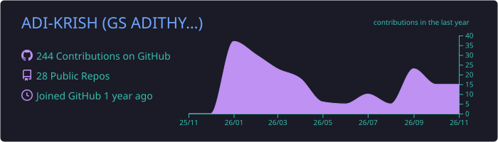
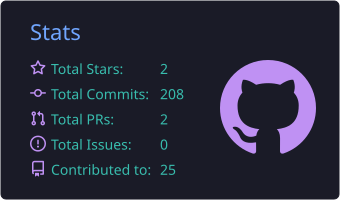
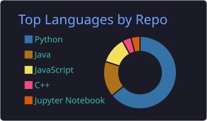
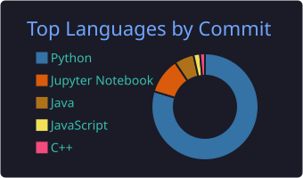
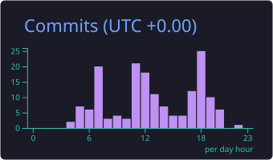

  
  

  
  

---

## 👨‍💻 About Me

I'm a computing student at **Amrita School of Computing, Amritapuri**, focused on **AI systems, algorithm design and software engineering**. I like projects where an idea has to survive contact with real data, real latency and real users: agentic pipelines, memory for long-horizon agents, reinforcement learning and data platforms.

- 🔭 Currently building **agentic AI platforms** and **episodic memory for agents**
- 🧠 Exploring **multi-agent RL**, **NL-to-SQL analytics** and **satellite + geospatial ML**
- 🌱 Sharpening system design, evaluation and clean engineering practice
- 💬 Ask me about: agents, RL, data engineering, algorithms

---

## 🛠️ Tech Stack

| Area | Focus |
|---|---|
| 🤖 **AI / Agents** | LLM agents, evaluation pipelines, episodic memory, NL-to-SQL |
| 🎮 **RL** | Hierarchical multi-agent reinforcement learning |
| 🗄️ **Data** | dbt warehouses, analytics engineering, ML on operational data |
| 🌍 **Geospatial** | Satellite imagery, AIS vessel tracking |
| ⚙️ **Core CS** | Algorithms, data structures, system design |

---

## 🚀 Featured Projects

<table>
<tr>
<td width="50%" valign="top">

### 🎙️ MNEMOS-PREP: Adaptive Interview Platform
Agentic AI platform for adaptive interview preparation and skill progression, with real-time group discussion rooms and asynchronous agentic scoring.

`Agents` `Evaluation` `Real-time` `Full-stack`

</td>
<td width="50%" valign="top">

### 🧠 MNEME: Episodic Memory for Agents
Long-horizon episodic memory architecture for AI agents. My final-year project direction.

`Agent Memory` `Retrieval` `Research`

</td>
</tr>
<tr>
<td width="50%" valign="top">

### 🏎️ FormulaOneRL
Hierarchical multi-agent RL that pairs a low-level driver policy with a high-level race strategy agent.

`RL` `Multi-agent` `PyTorch`

</td>
<td width="50%" valign="top">

### 🛰️ Oil Spill Attribution (SIH 26143)
Satellite-based oil spill detection linked to vessel identity through AIS data, built for NTRO.

`Computer Vision` `Geospatial` `AIS`

</td>
</tr>
<tr>
<td width="50%" valign="top">

### 📊 Enterprise Data Analyst Agent
Natural-language-to-SQL analytics agent that turns business questions into queries and answers.

`NL2SQL` `Agents` `Analytics`

</td>
<td width="50%" valign="top">

### 🏭 Industrial Operations Intelligence
Data engineering plus ML platform for operational insight in industrial settings.

`Data Engineering` `ML` `Pipelines`

</td>
</tr>
<tr>
<td colspan="2" valign="top">

### 🛒 Marketplace CX & Seller Analytics
dbt warehouse and analyses on the Olist dataset covering customer experience and seller performance.

`dbt` `SQL` `Analytics Engineering`

</td>
</tr>
</table>

> 📌 Pin your 6 favourite repos on your profile to match this section.

---

## 📈 GitHub Stats

 

---

## 🤝 Let's Connect

  

